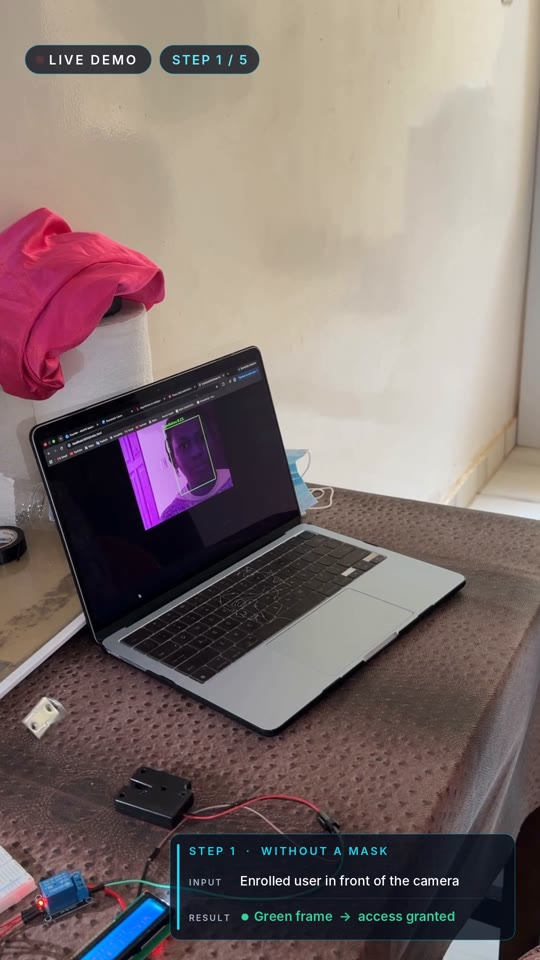
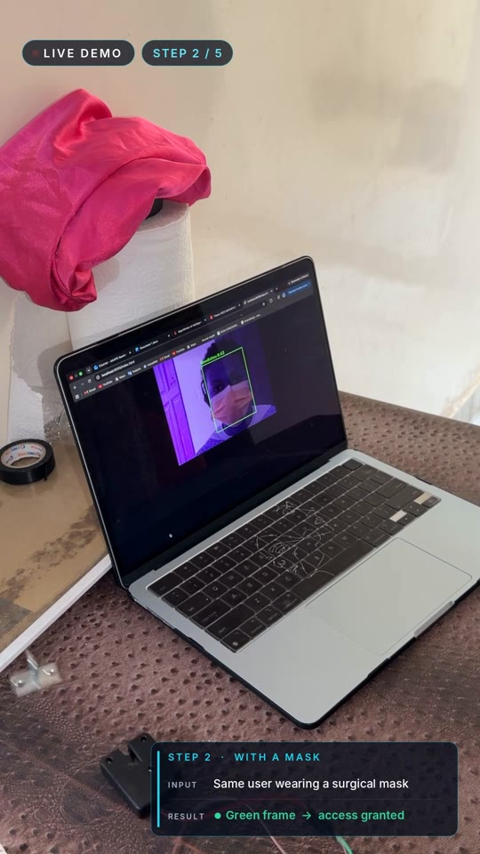
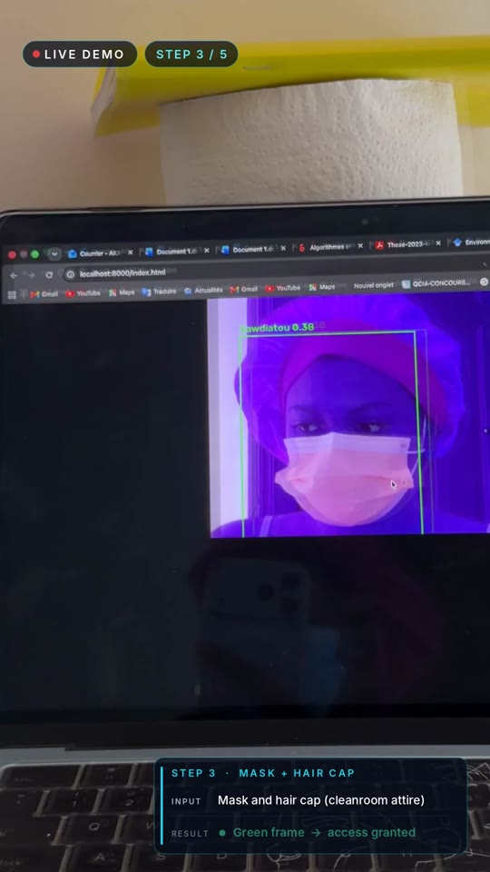
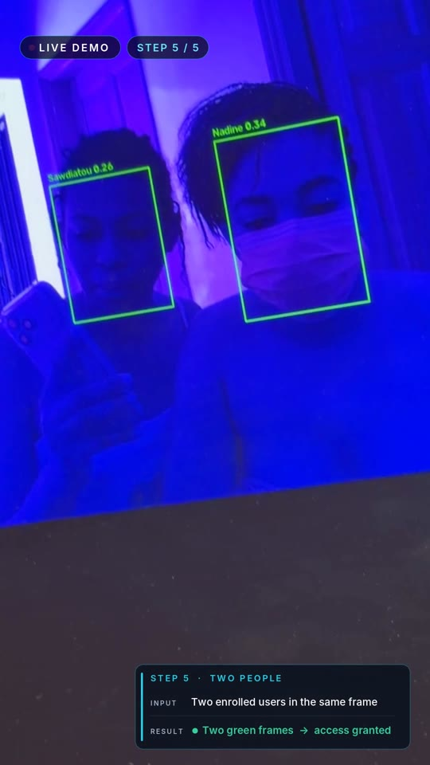
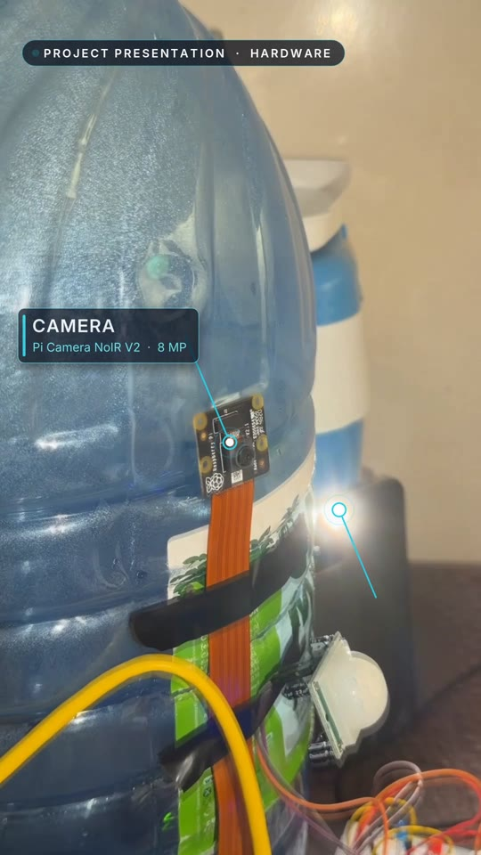

# AI-Powered Facial Recognition for Physical Access Control in the Pharmaceutical Industry

**University research prototype · Raspberry Pi 5 · On-device AI · Tamper-evident audit trail**

Master's research project, Université Cheikh Anta Diop de Dakar (UCAD), Senegal.
Author: **Sawdiatou Akapo**

> **Demo video (1 min 41 s):** [Watch the live demo](https://drive.google.com/file/d/1HBq2Pz5nWArZMOBNVB12gkiVgb_DzFUa/view?usp=sharing)

---

## The problem

Pharmaceutical sites protect their GMP critical areas (production, quality control, storage) with keys or badges. Keys and badges can be lost, lent or stolen, and they do not prove *who* actually entered. Staff in these areas also wear masks and hair caps, which makes many face recognition systems fail.

## The solution

A low-cost embedded system that opens a door only for enrolled staff, recognized by their face, **even when they wear a surgical mask and a hair cap**. Every access attempt is written to a tamper-evident audit trail. All the AI runs locally on a Raspberry Pi 5: no cloud service and no paid API.

| Without a mask | With a mask | Mask + hair cap | Two people |
|:---:|:---:|:---:|:---:|
|  |  |  |  |

**Green frame = identity verified, access granted.** An unknown person gets no match and access is refused.

## Key features

- Facial recognition without a mask, with a surgical mask, and with mask **and** hair cap (cleanroom attire)
- Enrollment of each person with and without personal protective equipment (PPE)
- Unknown individuals are refused
- Several people recognized in the same frame
- **Tailgating detection**: a person detector flags a second person following an authorized one
- **Tamper-evident audit trail (ALCOA+)**: every access event is stored in a hash-chained SQLite log, and an Ed25519-signed external anchor makes any deletion or truncation of the log detectable
- Live annotated camera stream in a web browser on the local network
- Evaluation tools: rank-1 identification, genuine/impostor score distributions, false acceptance test with a person removed from the gallery, processing time measurements

## How it works

```
Pi Camera ─► Face detection ─► Face embedding ─► Identity match ─► Access decision ─► Audit trail
(Picamera2)    (SCRFD)          (ArcFace,         (cosine distance   (relay + lock,     (hash-chained
                                 512-D vector)     vs enrolled        LCD, LEDs,         SQLite log +
                                                   gallery, 0.50)     buzzer)            signed anchor)
```

1. **Capture**: Picamera2 streams frames to the Raspberry Pi 5.
2. **Detection**: SCRFD locates every face in the frame.
3. **Embedding**: ArcFace converts each face into a normalized 512-dimension vector.
4. **Matching**: the vector is compared with the enrolled gallery (`encodings/buffalo.pkl`) using cosine distance, with a decision threshold of 0.50.
5. **Decision**: on a match, the relay releases the solenoid lock, the green LED lights up, the LCD shows the name and the buzzer confirms. Otherwise the red LED signals a refusal.
6. **Traceability**: the event is appended to the audit trail (`logs/audit_trail.db`).

Pretrained models: InsightFace `buffalo_l` (SCRFD + ArcFace) executed with ONNX Runtime on the CPU. No training is done on the board. `buffalo_l` replaced an earlier DeepFace/Facenet512 pipeline because it performs better on masked faces.

## Hardware

| Component | Role |
|---|---|
| Raspberry Pi 5 (4 GB RAM) | Runs the whole AI pipeline on-device |
| Pi Camera NoIR V2 (Sony IMX219, 8 MP) | Captures the face |
| LED light source | Illuminates the face |
| PIR motion sensor | Detects a person approaching |
| Relay module | Switches the door lock |
| 5 V solenoid lock (fail-secure) | Physical door lock |
| Adjustable AC/DC power adapter set to 5 V | Separate power supply for the lock |
| 16x2 LCD (I2C) | Displays the access status |
| Buzzer, green and red LEDs | Audible and visual feedback |
| Breadboard and jumper wires | Circuit assembly |

**GPIO wiring (BCM numbering)**, defined in `controle_peripheriques.py`:

| Device | GPIO |
|---|---|
| Relay (lock) | 17 |
| Green LED | 27 |
| Red LED | 22 |
| Buzzer | 23 |
| PIR sensor | 24 |

The lock stays open for 2 seconds after a granted access.



## Repository structure

| Group | Scripts |
|---|---|
| Access control (main) | `controle_acces_buffalo.py`: real-time recognition with buffalo_l, web stream, lock, LCD and audit trail |
| Tailgating | `controle_talonnage.py`: access control plus HOG person detection |
| Earlier versions (kept for comparison) | `controle_acces_web.py`, `controle_acces_epi.py`, `controle_acces.py` (DeepFace / Facenet512) |
| Enrollment | `encoder_buffalo.py` (builds the gallery), `enroler_epi_buffalo.py` (adds PPE photos of a person) |
| Hardware | `controle_peripheriques.py` (relay, LEDs, buzzer, PIR), `ecran_lcd.py` (LCD) |
| Audit trail | `db_audit.py` (hash-chained SQLite log), `ancrage.py` (Ed25519-signed external anchor) |
| Evaluation | `metriques_buffalo.py`, `far_exclusion.py`, `comparer_modeles.py`, `evaluation.py`, `evaluation_identification.py`, `mesurer_temps_buffalo.py`, `test_*.py` |

## Installation (Raspberry Pi OS)

```bash
sudo apt update
sudo apt install -y python3-picamera2 python3-opencv python3-lgpio i2c-tools

git clone https://github.com/sawdiatou0601-a11y/facial-recognition-access-control.git
cd facial-recognition-access-control
python3 -m venv --system-site-packages face_env
source face_env/bin/activate
pip install -r requirements.txt
```

The `buffalo_l` models are downloaded automatically by InsightFace on first use.

## Usage

**1. Enroll authorized staff**

Place photos in `dataset/<Name>/*.jpg` (one folder per person), then build the gallery:

```bash
python3 encoder_buffalo.py
```

Add photos of a person wearing a mask and hair cap (a backup of the gallery is made first):

```bash
python3 enroler_epi_buffalo.py <photo_folder> <Name>
```

**2. Run access control**

```bash
python3 controle_acces_buffalo.py
```

The annotated camera stream can then be viewed in a web browser on the same local network.

With tailgating detection:

```bash
python3 controle_talonnage.py
```

**3. Evaluate**

```bash
python3 metriques_buffalo.py            # rank-1 identification and score distributions
python3 far_exclusion.py <Name> [N]     # false acceptance test: <Name> is removed from the gallery, N live attempts
```

## Privacy and data protection

Face photos (`dataset/`), embeddings (`encodings/`), the audit trail (`logs/`) and the signing key are personal or secret data. They stay **only on the device** and are **excluded from this repository** by `.gitignore`.

## Limitations and next steps

This is a university prototype built with low-cost components. An industrial deployment in a pharmaceutical facility will require:

- a more powerful edge AI platform (for example NVIDIA Jetson);
- industrial cameras with liveness detection (anti-spoofing against photos and screens);
- certified access control hardware;
- integration of the audit trail with the site's quality system, in line with GMP, EU GMP Annex 11 and ALCOA+;
- validation on a larger group of users, with reported FAR and FRR.

## Author

**Sawdiatou Akapo**
Master 2 in Applied Physics: Electronics, Systems and Telecommunications (Networks), UCAD, Dakar
Contact: akaposawdiatou@gmail.com
